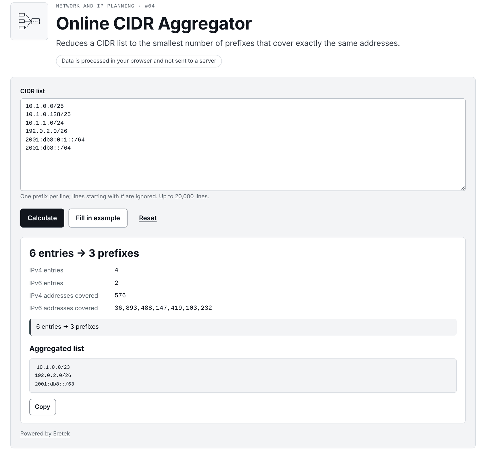

# CIDR Aggregator

Reduce an IPv4 and IPv6 CIDR list to the shortest list covering exactly the same addresses. No gaps are covered, families stay separate; for route summaries and ACLs.

## Try it live

- [Türkçe](https://network.eretek.com/araclar/cidr-birlestirici)
- [English](https://network.eretek.com/en/tools/cidr-aggregator)
- [Deutsch](https://network.eretek.com/de/werkzeuge/cidr-zusammenfasser)



## What it does

Reduces a CIDR list to the smallest number of prefixes that cover exactly the same addresses.

Firewall objects, prefix lists and allow lists grow into hundreds of overlapping or adjacent lines. Summarising by hand either lets extra addresses in or leaves a block out. The tool produces the shortest CIDR list that is **exactly equivalent** to the input: it never adds an address that was not covered.

## Where it helps

Put the output into a prefix list, object group or allow list. The number of covered addresses must equal the input; the tool shows it per family.

A more aggressive summary (e.g. a /16) is a deliberate decision that covers extra addresses; the tool does not create lossy summaries.

## How to use it

1. Paste one CIDR per line; IPv4 and IPv6 may be mixed.
2. An address without a prefix counts as /32 or /128. Lines with host bits set (e.g. 10.1.0.5/24) are converted to the network and flagged.
3. Press Calculate and copy the result.

### Fields

| Field | Description |
|---|---|
| CIDR list | One prefix per line; lines starting with # are ignored. Up to 20,000 lines. |

## Example input

Press **Fill in example** in the tool to load this input.

**CIDR list**

```text
10.1.0.0/25
10.1.0.128/25
10.1.1.0/24
192.0.2.0/26
2001:db8:0:1::/64
2001:db8::/64
```

**Expected result:** 6 entries reduce to 3 prefixes: 10.1.0.0/23, 192.0.2.0/26, 2001:db8::/63.

## Method and assumptions

Each prefix becomes a [first, last] address range; ranges are sorted and overlapping or adjacent ones merged. Each merged range is split into CIDRs using the largest aligned blocks. The result is the minimum number of prefixes covering the same set.

IPv4 and IPv6 are handled separately with 128-bit integer arithmetic. Two adjacent but unaligned blocks cannot become one prefix (10.0.1.0/24 + 10.0.2.0/24 do not merge, because the /23 boundaries are 10.0.0.0 and 10.0.2.0).

## Limits and common mistakes

- No lossy summaries that cover extra addresses.
- Next hop and metric are ignored; only the address set is merged. Before merging prefixes that point to different next hops, check them with the Static Route Inventory Diff.

## Run it locally

The tool is plain HTML, CSS and JavaScript with no build step and no dependencies.

```bash
git clone https://github.com/eretek/cidr-aggregator.git
cd cidr-aggregator
node scripts/serve.js        # or: python3 -m http.server 8080
```

Open <http://127.0.0.1:8080/>. Add `?lang=tr` or `?lang=de` for Turkish or German; without it the page follows the browser language and falls back to English. You can also open `index.html` directly from disk.

Run the tests (Node.js 18 or later):

```bash
node test/run.js    # or: npm test
```

The tests run the tool's own fixtures and the worked examples in all three languages without a browser.

## How it works

All processing happens in your browser. The tool makes no network requests, uses no cookies or browser storage, and does not upload files you select.

No server-side component is needed. The version on the Eretek website renders the same page through a private WordPress plugin; that plugin only produces the page markup and is not part of this repository.

| Path | Purpose |
|---|---|
| `index.html` | Page shell |
| `src/app.js` | Builds the page in Turkish, English or German from `src/data.js` |
| `src/data.js` | Field definitions, examples and all texts in three languages |
| `src/core.js` | Shared runtime: validation, number formats, result rendering, CSV/ICS export |
| `src/tool.js` | The calculation or analysis for this tool |
| `docs/screenshot.png` | Screenshot used in this README |
| `src/lib/ip.js` | IPv4/IPv6 library (BigInt) |
| `src/tools.css`, `src/page.css` | Styles |
| `test/run.js`, `test/cases.json` | Headless tests |

## License and attribution

This tool is released under the [Eretek Website Attribution License](LICENSE). You may use, modify and redistribute it, including commercially. If you make it available on a website or web application, show a visible, clickable credit linking to https://eretek.com/ on every page where the tool is available, for example:

```html
<a href="https://eretek.com/">Powered by Eretek</a>
```

You may add `rel="nofollow"` to the link. Keep the copyright notice and license text in copies and redistributions.
